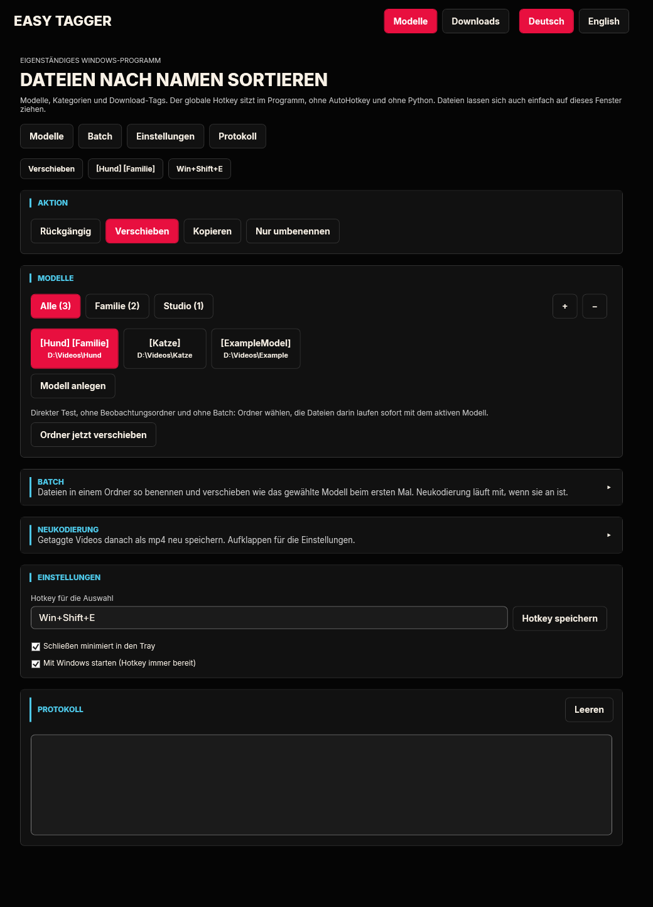
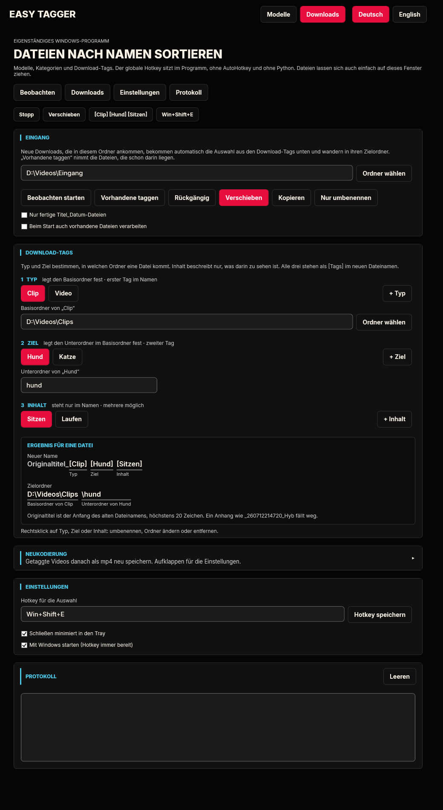

# Easy Tagger

A standalone Windows program for renaming and moving video files. It does not need Python or AutoHotkey.

The window uses a dark layout: black background, a red section bar, chip buttons, and a red highlight for the active selection.

## Start

Double-click `start.bat`. That requires the .NET 8 SDK. Settings are stored in `%LocalAppData%\EasyTagger\config.json`, outside the project folder.

The default hotkey is `Win+Shift+E`. It opens the model or download picker for the files selected in Explorer, even when the window is in the tray. Dragging files onto the window opens the same picker. In the picker, typing searches the models, Enter picks, and 1–9 pick a model that has a number key. The tabs at the top, or Ctrl+Tab, switch between models and downloads; the files are then tagged with that tab’s action and re-encoding, while the main window and a running download watch stay as they are. To change the hotkey, click the field under Settings and press the new combination. Closing the window sends it to the tray. Quit from the tray menu.

## FFmpeg

Re-encoding is optional. When it is on, Easy Tagger needs both `ffmpeg` and `ffprobe`. It looks beside `EasyTagger.App.exe`, then on your PATH, then in `C:\ffmpeg` or `C:\Program Files\ffmpeg\bin`. Files are re-encoded one after another. The status row and the tray tooltip show the progress, and Cancel stops the running file and the ones still waiting. Those files stay tagged, just not re-encoded.

Double-click `install-ffmpeg.bat` to install the essentials build and put it on your PATH. [Install FFmpeg on Windows and add it to PATH](https://ffmpeg-cookbook.com/en/articles/install-ffmpeg/) explains the same steps by hand. After that, quit Easy Tagger from the tray and start it again.

## Profiles

**Models** assigns a name and a destination folder. Categories added with `+` filter the buttons. The “also in the file name” option writes the category into the name as well. A `[]` tag typed directly into the name is kept when you save.

**Downloads** builds a name from type, target, and content, for example `[Clip] [Hund] [Sitzen]`. Type and target decide the folder: the type’s base folder plus the target’s subfolder. Content only goes into the name, and several can be on at once. The result box under the three steps labels each part of the name and the folder with the step it came from, and says so when a base folder is missing.

## Examples

The screenshots use the built-in sample names Hund, Katze, Familie, and Studio.

### Models

### Downloads

## License

The program is released under the [MIT License](LICENSE). The Inter font files in `src/EasyTagger.App/Fonts` stay under the SIL Open Font License.
